

  

<h1 align="center">Gloopico</h1>

  Every Claude Code and Codex session becomes a squishy slime that roams above your taskbar (Windows) or Dock (macOS). 
  It sweats while it works, hops when it needs you, and beams when it's done.

  
  
  
  

  <a href="https://gloopico.com">gloopico.com</a> · <a href="#install">Install</a> · <a href="#what-the-slimes-tell-you">What the slimes tell you</a> · <a href="#features">Features</a> · <a href="#privacy">Privacy</a> · <a href="#faq">FAQ</a> · <a href="https://github.com/gloopico/homebrew-tap/issues">Feedback</a>

  

⭐ Like Gloopico? A star on this repo helps a lot — it's how we get into Homebrew's official list.

## Why Gloopico

Run a few agent sessions at once and something always slips: one has been sitting on a permission prompt for ten minutes,
another finished a while ago, a third ran into the usage limit. Gloopico puts every session where you'll catch it out of the
corner of your eye. One slime per session, and the way it moves tells you what it's up to.

- **Know at a glance** which session is working, waiting for you, done, stopped by a limit or asleep
- **One click** takes you to that session's terminal or editor tab
- **Stays out of your way**: clicks pass straight through, and sounds and notifications are up to you
- **Private and free**: your chats never leave your computer, there's no account, and every feature is free

## Install

| | Download | Package manager |
|---|---|---|
| **Windows** | [Gloopico-win-Setup.exe](https://github.com/gloopico/homebrew-tap/releases/latest/download/Gloopico-win-Setup.exe) | `winget install gloopico` |
| **macOS** | [Gloopico-mac.zip](https://github.com/gloopico/homebrew-tap/releases/latest/download/Gloopico-mac.zip) | `brew install --cask gloopico/tap/gloopico` |

> WinGet is in review and Scoop is coming soon. Until then, grab the installer from [Releases](https://github.com/gloopico/homebrew-tap/releases).

- **Windows:** run the installer. It installs just for you (no admin rights needed) and starts Gloopico.
  The installer isn't code-signed yet, so SmartScreen may say "Windows protected your PC": choose **More info → Run anyway**.
  Rather not install anything? `Gloopico-win-Portable.zip` on [Releases](https://github.com/gloopico/homebrew-tap/releases) runs from any folder.
- **macOS:** unzip, move **Gloopico** to **Applications** and open it. It's signed and notarized by Apple.
  Opened it right from Downloads? It offers to move itself.

On first launch the settings window opens on **Integrations**: press **Connect** next to Claude Code / Codex and you're done.
Sessions that are already running join after a restart (for Claude, opening `/hooks` once also works).
Running them inside WSL on Windows? Each running distro gets its own **Connect** row.

The app updates itself on both Windows and macOS. Package-manager upgrades work too.

| Works with | |
|---|---|
| Agents | Claude Code and Codex on Windows and macOS, and inside WSL on Windows |
| Jump to the session | VS Code, Cursor, Windsurf, JetBrains IDEs, Orca and T3 Code, plus Terminal, iTerm2 and Ghostty on macOS. Other terminals get their window brought to the front |
| System | Windows 10 · 11 (64-bit), macOS 12 or later (Apple silicon & Intel) |

## What the slimes tell you

<table>
<tr>
<td align="center" valign="top" width="25%"> <b>Working</b> Bounces along, sweating. The icon on the left is the tool in use</td>
<td align="center" valign="top" width="25%"> <b>Needs you</b> Hops in place with ❗ while a permission prompt waits</td>
<td align="center" valign="top" width="25%">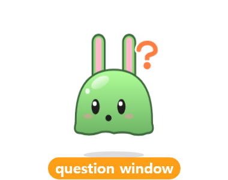 <b>Question for you</b> An orange ❓ while Claude waits for you to pick an answer</td>
<td align="center" valign="top" width="25%"> <b>Asked you</b> Tilts its head when the reply ends with a question</td>
</tr>
<tr>
<td align="center" valign="top"> <b>Done</b> A ✓ and a happy wiggle, awake until you click it or look at that session</td>
<td align="center" valign="top"> <b>Paused</b> You pressed Esc: it strolls with ⏸ until you click it or send a prompt</td>
<td align="center" valign="top">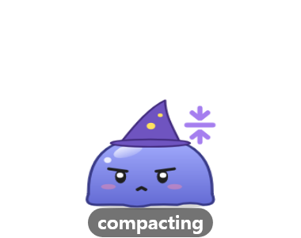 <b>Compacting</b> Squishes and puffs up with purple arrows while the chat is compacted</td>
<td align="center" valign="top"> <b>Asleep</b> Left alone for a while (15 min by default), it melts into a nap</td>
</tr>
<tr>
<td align="center" valign="top"> <b>Usage limit</b> Slumps with an empty battery. The card says when the limit resets</td>
<td align="center" valign="top">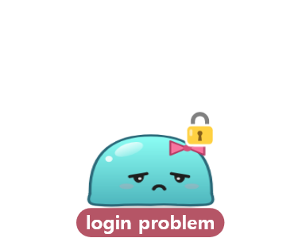 <b>Login problem</b> Slumps under a lock and looks up now and then: it needs you to sign in</td>
<td align="center" valign="top">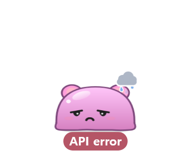 <b>API error</b> A gray rain cloud: the turn stopped on an API error</td>
<td align="center" valign="top"> <b>Limit reset</b> Jumps back up with a full battery</td>
</tr>
</table>

To the left of its head it stacks what's running beside the session:

<table>
<tr>
<td align="center" valign="top" width="25%"> Done, but a background command is still running ⏳ (it stays awake until that ends)</td>
<td align="center" valign="top" width="25%"> A dev server is listening 📡 (the card shows the port)</td>
<td align="center" valign="top" width="25%">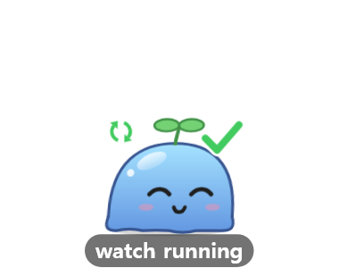 Something keeps running, like a watcher ↻</td>
<td align="center" valign="top" width="25%">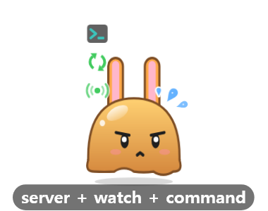 Several at once stack up: server, watcher and the current command</td>
</tr>
<tr>
<td align="center" valign="top">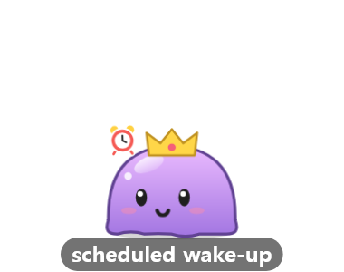 A wake-up is scheduled ⏰ (the card says when)</td>
<td align="center" valign="top">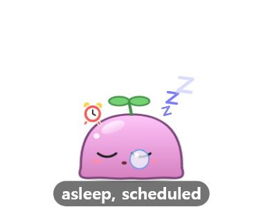 Asleep, with a wake-up scheduled</td>
<td align="center" valign="top">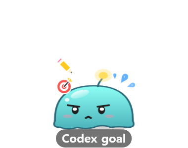 A Codex <code>/goal</code> in progress 🎯</td>
<td align="center" valign="top">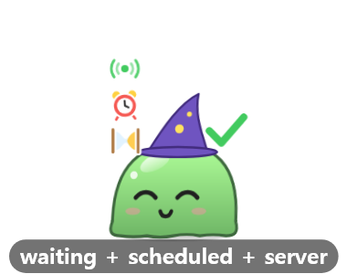 Done, with a shell, a schedule and a server still going</td>
</tr>
</table>

While a tool runs, its icon sits at the top of that column:

<table>
<tr>
<td align="center" valign="top" width="20%"> Reading / searching</td>
<td align="center" valign="top" width="20%">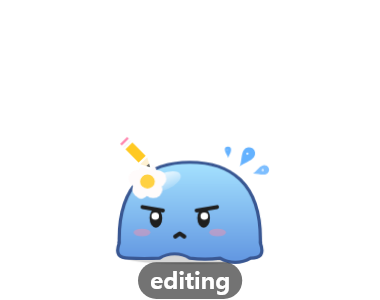 Editing</td>
<td align="center" valign="top" width="20%">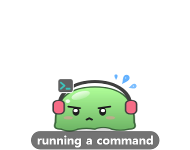 Running a command</td>
<td align="center" valign="top" width="20%">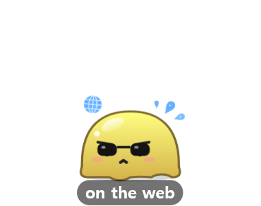 On the web</td>
<td align="center" valign="top" width="20%">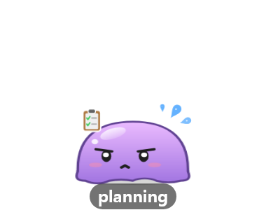 Updating its to-do list</td>
</tr>
<tr>
<td align="center" valign="top">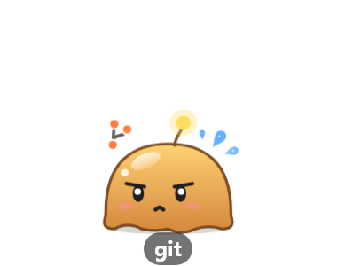 git</td>
<td align="center" valign="top"> Running tests</td>
<td align="center" valign="top">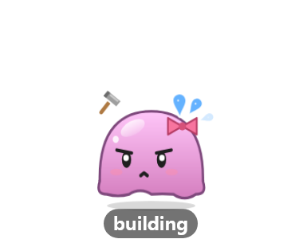 Building</td>
<td align="center" valign="top">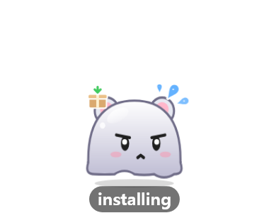 Installing packages</td>
<td align="center" valign="top">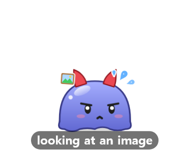 Looking at an image</td>
</tr>
<tr>
<td align="center" valign="top">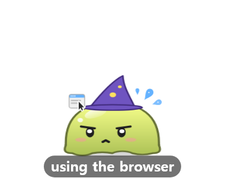 Using a browser</td>
<td align="center" valign="top">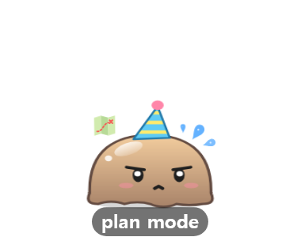 Plan mode</td>
<td align="center" valign="top">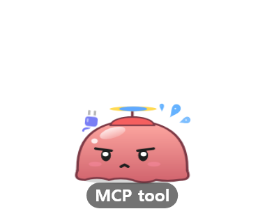 An MCP tool</td>
<td align="center" valign="top">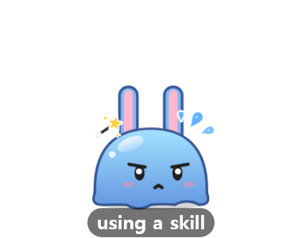 Using a skill</td>
<td></td>
</tr>
</table>

And it reacts to what happens, most of the time with a little sound of its own (each one can be turned off):

<table>
<tr>
<td align="center" valign="top" width="20%">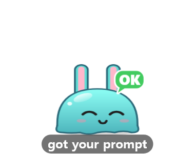 Got your prompt: a nod and off it goes</td>
<td align="center" valign="top" width="20%">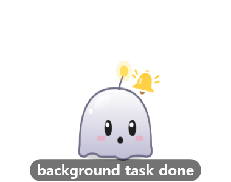 A background task finished and it carries on 🔔</td>
<td align="center" valign="top" width="20%">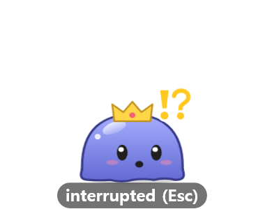 You pressed Esc</td>
<td align="center" valign="top" width="20%">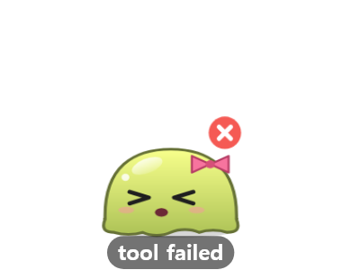 A tool failed ❌</td>
<td align="center" valign="top" width="20%">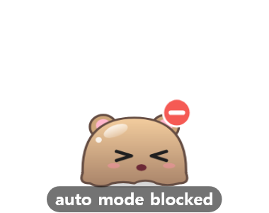 Auto mode blocked a tool 🚫</td>
</tr>
<tr>
<td align="center" valign="top">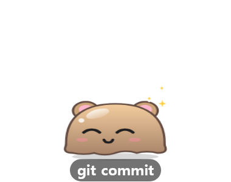 git commit ✨</td>
<td align="center" valign="top"> git push: a rocket takes off 🚀</td>
<td align="center" valign="top">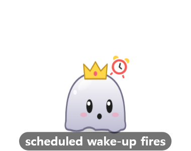 A scheduled wake-up fires ⏰</td>
<td align="center" valign="top">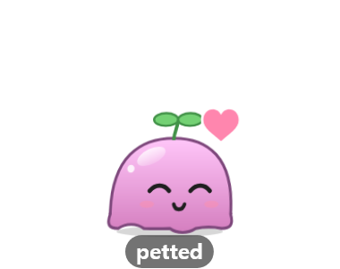 Petted 💗</td>
<td align="center" valign="top">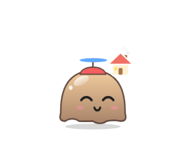 Session ended: off home 🏠</td>
</tr>
</table>

Close the terminal without ending the session and it vanishes in a puff of cloud instead.

## Features

**Subagents tag along.** Each subagent becomes a little slime of the same color that follows its parent, showing the tool it's using
(or a tiny prop: 🔍 Explore, 📋 Plan) while the parent waits with a guide flag. A background session started with `claude --bg` splits right off its parent.

<table>
<tr>
<td align="center" valign="top" width="33%"> Three subagents at work, the parent waiting with a guide flag</td>
<td align="center" valign="top" width="33%">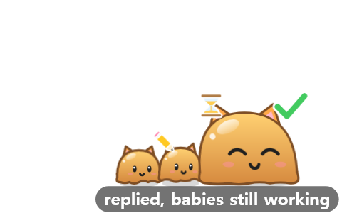 The parent replied, the babies are still working</td>
<td align="center" valign="top" width="33%">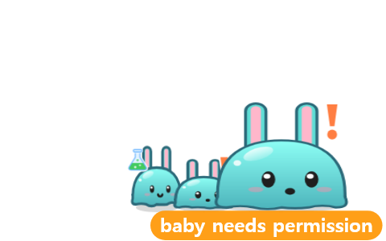 A baby needs permission ❗</td>
</tr>
<tr>
<td align="center" valign="top">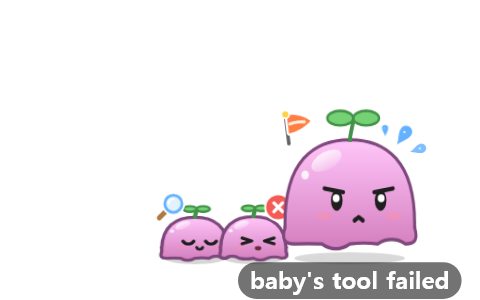 A baby's tool failed ❌</td>
<td align="center" valign="top">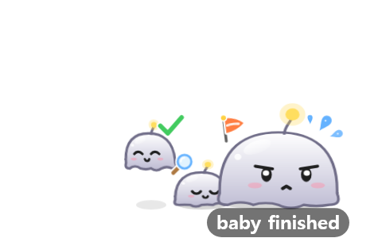 A baby finished ✓ and pops off</td>
<td align="center" valign="top">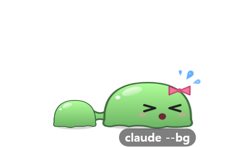 <code>claude --bg</code>: the new session splits off</td>
</tr>
</table>

**One click to the session.** Click a slime (or its card) to jump to that session's window, and straight to its terminal tab in
VS Code, Cursor and Windsurf, JetBrains IDEs, Terminal, iTerm2 and Ghostty on macOS, and Orca, or to its thread in T3 Code.
Editors need a tiny extension / plugin, one click in Settings → Integrations. Other terminals (Windows Terminal, Warp, …) go to the window.
T3 Code is verified on Windows so far.

**Every session, at a glance.** Not into wandering slimes? Use the card window: one card per session with its model, state and
time, subagents, and your Claude / Codex 5-hour and weekly usage at the bottom. Sort cards into named groups, or shrink it all into
a see-through widget that stays on top. The **History** tab keeps recently closed sessions, with **Copy command** to resume one in
the terminal of your choice and **Copy path** for its folder.

<table>
<tr>
<td valign="top" width="45%"></td>
<td valign="top">  
<b>Usage limits.</b> When a turn hits a limit the slime slumps and the card tells you when it resets; when that time comes it hops back up.
 Claude's live numbers come through an optional status-line link in Settings → Integrations (Pro / Max plans). Codex's are read from its local logs.</td>
</tr>
</table>

**Make it yours.** Each session gets its own color and accessory, and keeps them. Right-click → Customize to change the name tag
(text, size, colors), body color, accessory and size. Achievements (clicks, pets, finished tasks and more) unlock new accessories one by one.

<table>
<tr>
<td valign="top" width="55%"></td>
<td valign="top"></td>
</tr>
</table>

**Stays out of your way.** Clicks pass straight through to the window behind unless you're on a slime. Every sound can be turned
off on its own, and system notifications (off by default) can tell you when a session needs you, finishes or stops.
Pin a slime anywhere (even mid-air), keep one on top of other windows, or hide one from the desktop. Let them roam across every
monitor or keep them on one. And when you haven't touched the mouse or keyboard for 5 minutes, it lowers its frame rate.

<table>
<tr>
<td align="center" width="170"></td>
<td><b>Naps under a cloud.</b> After a long nap a slime can tuck itself into a cloud blanket and leave the desktop until it has
something to tell you, then pop back out in the same spot (off by default; its card stays in the card window).</td>
</tr>
</table>

**Keeps your PC awake, if you like.** The cup button in the card window and the tray keeps your computer from sleeping: off,
only while sessions work (or wait on background commands and subagents), or always. The button next to it turns the screen off
right away while the work carries on.

**Little things.** Drag one to pick it up, rub one to pet it, click one to make it boing. Light and dark themes, launch at login,
and English, 한국어, 日本語, 简体中文, Español, Deutsch, Français and Português.

## Privacy

**Your chats never leave your computer.** There's no account and no sign-in.

- **Hooks.** Connecting adds hooks to Claude Code (`~/.claude/settings.json`) and Codex (`~/.codex/hooks.json`). On each event they run
  Gloopico's small hook program, which writes one status file per session to `~/.claude/agent-status/`: the state, the current tool with a
  one-line hint (a command or file path), pending permission prompts, the project folder, git branch and model, and the IDs it needs to find
  the process and terminal tab. Your prompts and the replies are never written there. The hook never goes online and never prints anything
  into your session.
- **The app reads, on your machine only:** those status files, your session transcripts (for the model, usage limits and interruptions),
  Codex's local databases (goals, turn errors) and the running processes (which sessions are alive, the commands and dev servers running beside
  them, which window to jump to). When you click a slime it talks only to apps on your computer: a `vscode://` link, the JetBrains IDE's
  built-in server on 127.0.0.1, Orca's command line, T3 Code's local thread list.
- **Logs** (`gloopico.log`) stay on your machine and leave out window titles, project names and commands.

The app goes online for three things only:

| What | When | What's sent |
|---|---|---|
| Update check | 1 minute after launch, then every 6 hours, and when you press "Check for updates" | A plain request for this repository's [Releases](https://github.com/gloopico/homebrew-tap/releases) on GitHub. No token, no ID |
| First-launch count | Once, the first time an installed copy starts | OS, app version and UI language to `api.gloopico.com`. No device ID, and the IP address isn't stored, so it can't be traced back to you |
| Coupon | Only when you redeem a supporter coupon | The code, a random device ID made by the app, OS, app version and language to `api.gloopico.com` |

The Support button and gloopico.com links simply open your browser.

## FAQ

**A session doesn't show up.** A slime appears with the session's first prompt, not when you merely open it. Sessions that were
already running when you pressed **Connect** join after a restart (for Claude, opening `/hooks` once also works).

**Settings says "Needs repair".** That happens after you move the app, or after an update that listens to more events.
Press **Reconnect** in Settings → Integrations.

**Does it slow Claude Code or Codex down?** On each event the hook writes one small file and exits, in milliseconds
(about 10 ms on Windows, a little longer inside WSL). It never goes online and never prints into your session.

**Does it read my code or my chats?** It never sends them anywhere. Your transcripts are read on your own computer only, for the
model name, usage limits and interruptions. See [Privacy](#privacy).

## Uninstall

- **Windows:** uninstall Gloopico from Settings → Apps (or `winget uninstall Gloopico.Gloopico`). The uninstaller disconnects the
  Claude Code / Codex hooks for you. Using the portable zip? Press **Disconnect** in Settings → Integrations first.
- **macOS:** press **Disconnect** in Settings → Integrations, then `brew uninstall --cask gloopico` (add `--zap` to also remove saved
  settings) or move Gloopico to the Trash. Forgot to disconnect? The hooks simply stay quiet once the app is gone.

Settings, looks and achievements stay in `%APPDATA%\gloopico` (Windows) / `~/Library/Application Support/gloopico` (macOS) so a reinstall
picks up where you left off. Delete that folder and `~/.claude/agent-status` for a clean slate.

## Feedback

Bugs, ideas, questions: [open an issue](https://github.com/gloopico/homebrew-tap/issues). They're very welcome.

Gloopico is a personal project. Its source code lives in a private repository; this public one carries everything you install
(installers, update feeds, package-manager manifests), and it's the place for issues and ⭐s.

## What's in here

| Path | |
|---|---|
| Releases | Installers (`Gloopico-win-Setup.exe`, `Gloopico-win-Portable.zip`, `Gloopico-mac.zip`) and update feeds |
| `Casks/` | Homebrew cask (`brew install --cask gloopico/tap/gloopico`) |
| `assets/` | Pictures for this README |

The WinGet manifest is submitted to [microsoft/winget-pkgs](https://github.com/microsoft/winget-pkgs) as `Gloopico.Gloopico`.

---

Gloopico is a personal project, not affiliated with Anthropic or OpenAI. Claude Code and Codex are trademarks of their respective owners.
Every feature is free; if you'd like to treat the slimes, see <a href="https://gloopico.com/treat">gloopico.com/treat</a>.
