

  

<h1 align="center">Gloopico</h1>

  Every Claude Code and Codex session becomes a squishy slime that roams above your taskbar (Windows) or Dock (macOS). 
  It sweats while it works, hops when it needs you, and beams when it's done.

  
  
  
  

  <a href="https://gloopico.com">gloopico.com</a> · <a href="#install">Install</a> · <a href="#privacy">Privacy</a> · <a href="https://github.com/gloopico/homebrew-tap/issues">Feedback</a>

  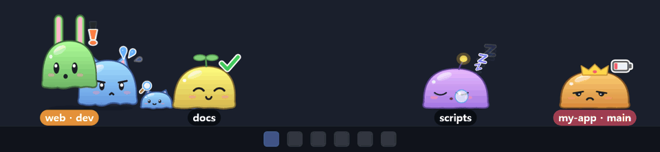

⭐ Like Gloopico? A star on this repo helps a lot — it's how we get into Homebrew's official list.

## Install

| | |
|---|---|
| macOS (Homebrew) | `brew install --cask gloopico/tap/gloopico` |
| Windows (WinGet) | `winget install gloopico` |
| Windows (Scoop) | `scoop bucket add gloopico https://github.com/gloopico/homebrew-tap` then `scoop install gloopico/gloopico` |
| Installer | [Releases](https://github.com/gloopico/homebrew-tap/releases) |

> WinGet is in review and Scoop is coming soon. Until then, grab the installer from [Releases](https://github.com/gloopico/homebrew-tap/releases).

Windows 10 · 11 (64-bit), macOS 12 or later (Apple silicon & Intel). Free.

On first launch the settings window opens on **Integrations**: press **Connect** next to Claude Code / Codex and you're done.
Sessions that are already running join after a restart (for Claude, opening `/hooks` once also works).

The app updates itself on both Windows and macOS. Package-manager upgrades work too.

## What the slimes tell you

<table>
<tr>
<td align="center" valign="top" width="25%">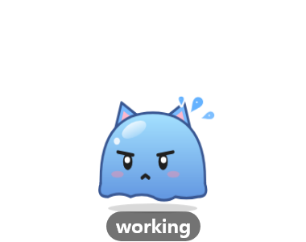 <b>Working</b> Bounces along, sweating. The icon on the left is the tool in use</td>
<td align="center" valign="top" width="25%">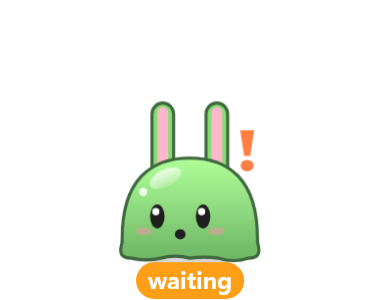 <b>Needs you</b> Hops in place with ❗ while a permission prompt waits</td>
<td align="center" valign="top" width="25%"> <b>Asked you</b> Tilts its head when the reply ends with a question</td>
<td align="center" valign="top" width="25%">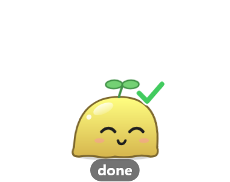 <b>Done</b> A ✓ and a happy wiggle, awake until you click it or look at that session</td>
</tr>
<tr>
<td align="center" valign="top"> <b>Paused</b> You pressed Esc: it strolls with ⏸ until you click it or send a prompt</td>
<td align="center" valign="top">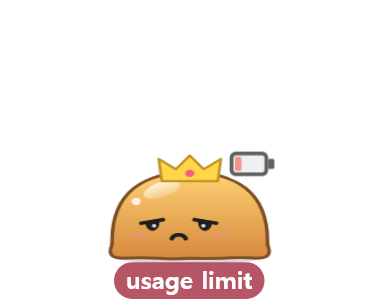 <b>Usage limit</b> Slumps with an empty battery (🔒 for login, a rain cloud for API errors)</td>
<td align="center" valign="top"> <b>Limit reset</b> Jumps back up with a full battery</td>
<td align="center" valign="top">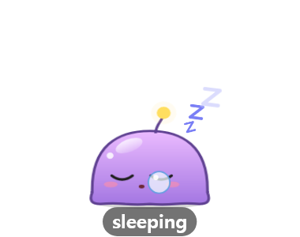 <b>Asleep</b> Left alone for a while (15 min by default), it melts into a nap</td>
</tr>
</table>

It shows what's going on beside the session too:

<table>
<tr>
<td align="center" valign="top" width="25%">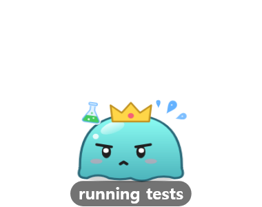 Running tests (also: reading, editing, building, git, web, MCP, skills …)</td>
<td align="center" valign="top" width="25%"> Done, but a background command is still running ⏳</td>
<td align="center" valign="top" width="25%">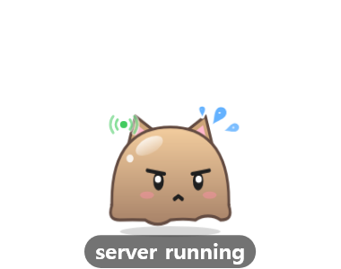 A dev server is up</td>
<td align="center" valign="top" width="25%">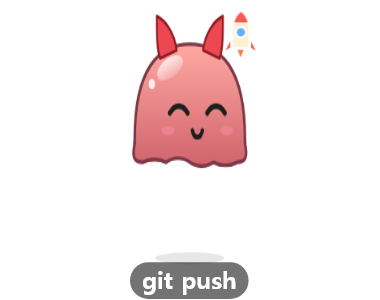 git push: a rocket takes off 🚀</td>
</tr>
</table>

## More

**Subagents tag along.** Each subagent becomes a little slime of the same color that follows its parent, showing the tool it's using
(or a tiny prop: 🔍 Explore, 📋 Plan) while the parent waits with a guide flag. A background session started with `claude --bg` splits right off its parent.

**One click to the session.** Click a slime (or its card) to jump to that session's window, and straight to its terminal tab in
VS Code, Cursor and Windsurf, JetBrains IDEs, Terminal, iTerm2 and Ghostty on macOS, and Orca, or to its thread in T3 Code.
Editors need a tiny extension / plugin, one click in Settings → Integrations. Other terminals (Windows Terminal, Warp, …) go to the window.
T3 Code is verified on Windows so far.

**Every session, at a glance.** Not into wandering slimes? Use the card window: one card per session with its model, state and
time, subagents, and your Claude / Codex 5-hour and weekly usage at the bottom. Or shrink it into a see-through widget that stays on top.

<table>
<tr>
<td valign="top" width="45%">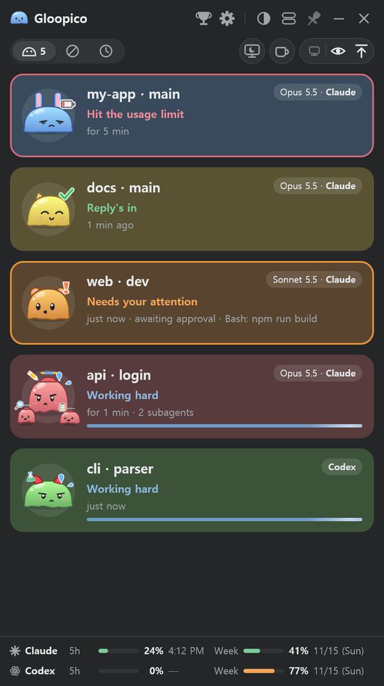</td>
<td valign="top">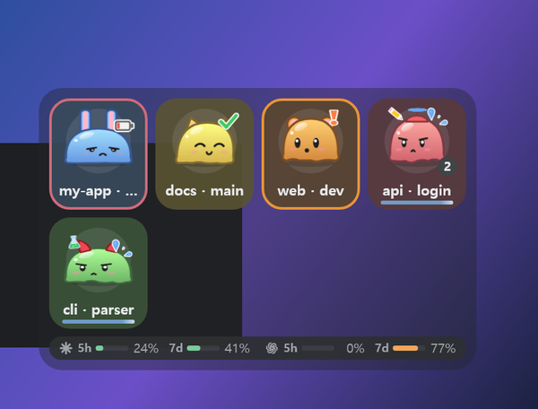  
<b>Usage limits.</b> When a turn hits a limit the slime slumps and the card tells you when it resets; when that time comes it hops back up.
 Claude's live numbers come through an optional status-line link in Settings → Integrations (Pro / Max plans). Codex's are read from its local logs.</td>
</tr>
</table>

**Make it yours.** Each session gets its own color and accessory, and keeps them. Right-click → Customize to change the name tag
(text, size, colors), body color, accessory and size. Achievements (clicks, pets, finished tasks and more) unlock new accessories one by one.

<table>
<tr>
<td valign="top" width="55%">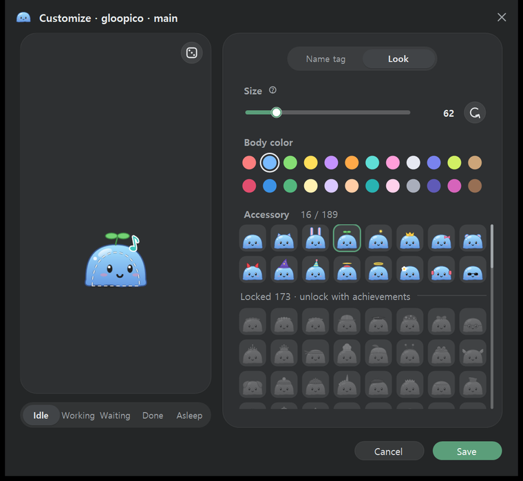</td>
<td valign="top">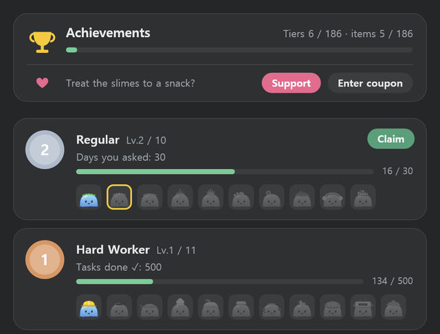</td>
</tr>
</table>

**Little things.** Drag one to pick it up, rub one to pet it, click one to make it boing. Clicks pass straight through to the window
behind unless you're on a slime, and every sound can be turned off. Pin a slime anywhere (even mid-air), let them roam across monitors,
or keep your PC awake while sessions work. English, 한국어, 日本語, 简体中文, Español, Deutsch, Français and Português.

## Privacy

**Your chats never leave your computer.** There's no account and no sign-in.

- **Hooks.** Connecting adds hooks to Claude Code (`~/.claude/settings.json`) and Codex (`~/.codex/hooks.json`). On each event they run
  Gloopico's small hook program, which writes one status file per session to `~/.claude/agent-status/`: the state, the current tool with a
  one-line hint (a command or file path), pending permission prompts, the project folder, git branch and model, and the IDs it needs to find
  the process and terminal tab. Your prompts and the replies are never written there. The hook never goes online and never prints anything
  into your session.
- **The app reads, on your machine only:** those status files, your session transcripts (for the model, usage limits and interruptions),
  Codex's local databases (goals, turn errors) and the running processes (which sessions are alive, the commands and dev servers running beside
  them, which window to jump to). When you click a slime it talks only to apps on your computer: a `vscode://` link, the JetBrains IDE's
  built-in server on 127.0.0.1, Orca's command line, T3 Code's local thread list.
- **Logs** (`gloopico.log`) stay on your machine and leave out window titles, project names and commands.

The app goes online for three things only:

| What | When | What's sent |
|---|---|---|
| Update check | 1 minute after launch, then every 6 hours, and when you press "Check for updates" | A plain request for this repository's [Releases](https://github.com/gloopico/homebrew-tap/releases) on GitHub. No token, no ID |
| First-launch count | Once, the first time an installed copy starts | OS, app version and UI language to `api.gloopico.com`. No device ID, and the IP address isn't stored, so it can't be traced back to you |
| Coupon | Only when you redeem a supporter coupon | The code, a random device ID made by the app, OS, app version and language to `api.gloopico.com` |

The Support button and gloopico.com links simply open your browser.

## Uninstall

- **Windows:** uninstall Gloopico from Settings → Apps (or `winget uninstall Gloopico.Gloopico`). The uninstaller disconnects the
  Claude Code / Codex hooks for you. Using Scoop or the portable zip? Press **Disconnect** in Settings → Integrations first.
- **macOS:** press **Disconnect** in Settings → Integrations, then `brew uninstall --cask gloopico` (add `--zap` to also remove saved
  settings) or move Gloopico to the Trash. Forgot to disconnect? The hooks simply stay quiet once the app is gone.

Settings, looks and achievements stay in `%APPDATA%\gloopico` (Windows) / `~/Library/Application Support/gloopico` (macOS) so a reinstall
picks up where you left off. Delete that folder and `~/.claude/agent-status` for a clean slate.

## Feedback

Bugs, ideas, questions: [open an issue](https://github.com/gloopico/homebrew-tap/issues). They're very welcome.

Gloopico is a personal project. Its source code lives in a private repository; this public one carries everything you install
(installers, update feeds, package-manager manifests), and it's the place for issues and ⭐s.

## What's in here

| Path | |
|---|---|
| Releases | Installers (`Gloopico-win-Setup.exe`, macOS app) and update feeds |
| `Casks/` | Homebrew cask (`brew install --cask gloopico/tap/gloopico`) |
| `bucket/` | Scoop manifest |
| `winget/` | WinGet manifests (copies of what is submitted to [microsoft/winget-pkgs](https://github.com/microsoft/winget-pkgs)) |
| `assets/` | Pictures for this README |

---

Gloopico is a personal project, not affiliated with Anthropic or OpenAI. Claude Code and Codex are trademarks of their respective owners.
Every feature is free; if you'd like to treat the slimes, see <a href="https://gloopico.com/treat">gloopico.com/treat</a>.
